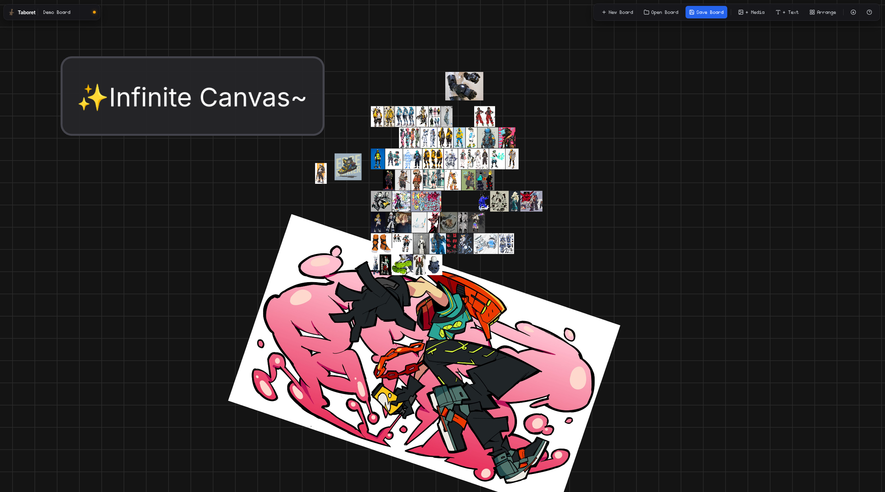
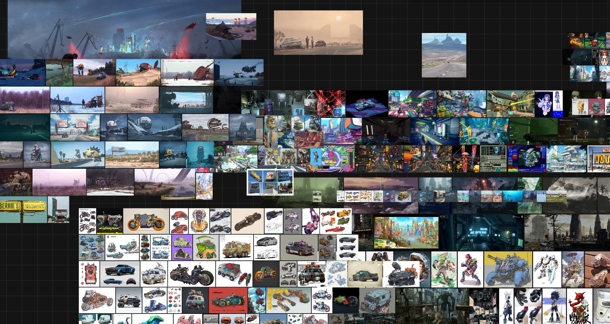

Taboret is a well featured and fast Reference Board for Linux, running on PixiJS and Tauri.

---

### Features

- Infinite Canvas with support for a massive amount of images
- Local File Storage with no weird formats
- Text
- Move, Scale, Rotate & Flip Images
- Image Groups & Labels
- Mass Arrange Options
- GIF & WEBM Support

### Planned Features
- Video (MP4) Support
- Better UI, with color, grid, keybinds, and canvas zoom options
- Faster Load Times with less hitching
- A way to link items on the canvas, similar to Obsidian
- Decal System that allows you to drag symbols and arrows onto the canvas
- Persistant User Settings across all boards
- Light Mode 😬
